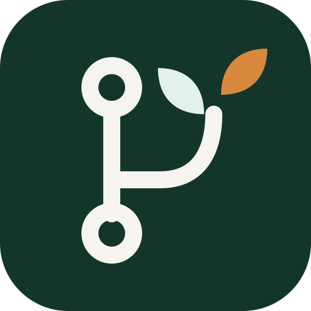
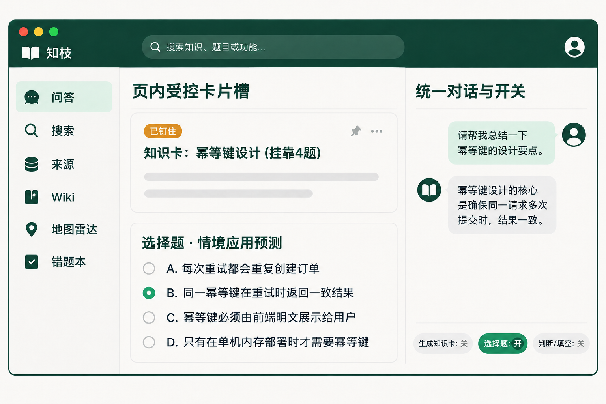

<div align="center">
  
  <h1>知枝 · Zhizhi Agent</h1>
  <p><strong>把平时读的文章、写的代码、问过 AI 的东西，整理成能查也能练的个人知识库。</strong></p>
  <p>资料丢进来，先洗干净再存成知识卡；每张卡自动配题，做错的单独记下来。</p>
  <p>
    <a href="https://github.com/sep-zxy/zhizhi-agent/actions/workflows/ci.yml"></a>
    <a href="https://github.com/sep-zxy/zhizhi-agent/actions/workflows/cd.yml"></a>
    <a href="LICENSE"></a>
  </p>
  <p>
    <a href="#这个项目要解决什么">要解决什么</a> ·
    <a href="#它怎么工作">它怎么工作</a> ·
    <a href="#界面和练题怎么设计">界面与练题</a> ·
    <a href="#现在做到哪一步了">当前进度</a> ·
    <a href="#跑起来看看">跑起来看看</a> ·
    <a href="docs/architecture.md">架构文档</a>
  </p>
</div>

## 这个项目要解决什么

写代码、看文档、刷技术视频、跟 AI 聊方案，这些事每天都在发生，但东西散在十几个地方。收藏夹吃灰，聊天记录翻不到，真正遇到同类问题还是得重新搜一遍。

知枝想做的是一件很具体的事：**给你一个带 AI 助手的知识库，而且能顺手出题把你考会。**

你在里面可以做四件事：

- **收资料**：把网页链接、B 站/YouTube 视频、本地 PDF/HTML/Markdown 文件，或者你自己的 Git 提交记录喂给它。
- **存知识卡**：整理成一个个独立的知识点页面，可以修改、查重、看历史版本，也能按主题串起来。
- **问问题**：只有一个聊天窗口。你问它问题时，它自己判断先翻你的知识库；库里没记过，就去网上搜，不胡说。
- **刷题和查漏**：每张知识卡背后挂着对应的练习题。做错了会进独立的错题本，知识地图里还能一眼看出哪一块还没学透。

项目目前还在早期开发，基座刚搭完，业务功能正按模块陆续补上。下面两张图画的是我们要做出来的样子，当前已经跑通的部分看[现在做到哪一步了](#现在做到哪一步了)。

## 它怎么工作


如果把杂乱的 PDF、长视频字幕、几十条零碎 Git commit 直接塞给主聊天模型，回答质量很快就会垮掉。所以我们把流程拆成了两段：

1. **先用插槽解析，再进主循环**
   每种来源都是一个独立插槽（支持内置插件，也可以挂外部 MCP 服务）。像 B 站、抖音这种经常改接口的站点，拆出去单独维护，拿掉任意一个也不影响主程序运行。
   文件进来之后，先交给后台的 AI 子循环处理表格、提取图片存起来，统一洗成干净的 Markdown，校验通过后再交给你选去向：**仅收藏**、**放待学**，或者**预览后存成知识卡**。

2. **Git 提交只留架构思路，不囤源码**
   采集器把一堆零散提交去噪合并后，先总结成架构层面的 Markdown（当时遇到什么问题、怎么取舍的），彻底脱离原仓库代码片段。以后原仓库删了，知识卡和题目照样独立可用。

3. **一套代码，个人电脑和团队服务器都能跑**
   从第一版起就做了多人账号隔离，所有数据都按 `user_id` 分开。你一个人想在本地用，不用装 Docker，直接 `pnpm dev` 就能跑嵌入式数据库；团队要部署到一台共享服务器，配个 PostgreSQL 连接串就能无缝切过去。

| 平时遇到的问题 | 在知枝里怎么用 |
|---|---|
| 搜到一篇好文章或长视频，怕收藏完就忘 | 丢进来源页，后台洗成图文 Markdown，预览删改后一键存成知识卡或放待学 |
| 项目一天提交几十次，想复盘却懒得翻 diff | 跨端 Git 采集器把同主题提交归并成 2～3 个架构要点，不含冗长源码 |
| 忘了自己以前记没记过某个坑 | 直接在问答页问；Agent 优先翻你的知识库并附出处，没找到再去联网搜 |
| 聊着聊着想把结论存下来，又怕 AI 乱建卡 | 平时关着「生成知识卡」开关只聊天；想存的时候打开开关，先预览，点保存才入库 |

## 界面和练题怎么设计



我们不想做成“全靠打字聊天”的黑盒界面，也不想让 AI 随机把整个页面改乱。

- **按功能分成 6 个独立页面**：问答、搜索、来源、Wiki、地图雷达、错题本，每个页面都有固定布局，点按钮就能直接操作，手机端也能自然变成底部 6 个 Tab。
- **页内放受控卡片槽，支持「钉住」**：在问答页里，Agent 可以把知识卡、草稿对比卡、选择题卡直接投到中间区域。你点一下卡片右上角的「钉住」，后面再怎么继续聊，它都不会把这张卡顶掉。退出重登时，记忆系统会把你的卡片排布和常用开关恢复回来。
- **题型做成工具，开关直接锁权限**：每种题型是一个独立的 Agent 工具。V1 先做好**选择题（带解析）**，后续再插判断题、填空题、问答题。界面上把哪个题型关了，后端就不会把这个工具发给模型，它绝对不会乱出题。
- **一张卡挂多道题，入库默认先出两道**：新知识卡点保存立即返回，后台异步默认出 2 道选择题——一道考**理解概念**，一道考**实际场景怎么用**（怕费 Token 可以在设置里关掉）。以后你又传了新文档补充这张卡，AI 会先看已有题目覆盖了没，没覆盖才补新题。
- **错题本完全独立，能归档能删**：错题页只做客观记录，不跟入库流程缠在一起。觉得某道错题已经彻底会了，可以直接归档或删掉，免得越攒越多没法看。
- **地图看全局，雷达指方向**：知识地图把相关的卡连起来，按掌握情况标颜色；知识雷达直接读这张地图，告诉你已经掌握了哪一块、缺了哪一块，推荐下一张值得学的卡。

## 现在做到哪一步了

开发基座已经搭完并跑通了本地与云端 CI（TypeScript 双面检查、`oxlint`、5 条静态门禁、单元测试、Web 构建全绿）：

- **已经跑通的基座**：
  - 全栈 TypeScript pnpm Monorepo，参考了 DeepSeek Harness 的工程规范与静态门禁。
  - 真实接入了 Pi Agent（`@earendil-works/pi-agent-core` 与 `@earendil-works/pi-ai`），支持 DeepSeek、OpenAI 及任意 OpenAI 兼容中转站；没配 API Key 时自动走官方 `fauxProvider` 跑完整工具循环，本地开发和测试不花 Token。
  - 18 张多租户表结构（Drizzle ORM），本地默认 PGlite 嵌入式数据库 + 本地文件存储 + 数据库队列（V1 不需要装 Redis 和 Docker）；填配置即切 PostgreSQL 与 S3/OSS。
  - Hono 服务端（注册/登录 JWT、租户隔离中间件、按页面存画布记忆、双通道 SSE 对话）与 React 19 + Tailwind 前端骨架（6 页路由、移动底栏、PWA 配置、问答页钉住与开关演示）。
- **接下来要补齐的 4 条业务线**（分工见 [docs/architecture.md](docs/architecture.md)）：
  1. 知识卡与主题页的完整增删改查、版本回退、中文搜索。
  2. 网页、视频截帧、本地文件解析插件与 AI 解析子循环，以及外部 Python MCP 解析示例。
  3. Win/Mac Git 采集器与知识地图渲染。
  4. 知识卡入库异步出 2 题与改卡判重、独立错题页、基于地图的知识雷达。

## 跑起来看看

需要 Node.js `>= 24.12.0` 和 pnpm `10.x`。本地跑**不需要 Docker**。

```sh
git clone https://github.com/sep-zxy/zhizhi-agent.git
cd zhizhi-agent
pnpm install
pnpm dev
```

启动后：
- 前端页面：`http://127.0.0.1:5173`
- 后端接口：`http://127.0.0.1:3080`（自动在 `.zhizhi/` 下初始化本地数据库和文件目录）

本地运行全部检查和测试：

```sh
pnpm run check:all
pnpm --filter @zhizhi/web run build
```

如果你想在共享服务器上用容器拉起 PostgreSQL（含 pgvector）和 MinIO：

```sh
docker compose -f deploy/docker-compose.yml up -d
```

仓库里已经配好了 GitHub Actions：每次 Push / PR 会跑 `ci.yml` 检查代码和构建；打 `v*` 标签或手动触发 `cd.yml` 会构建镜像推到 GHCR 并生成 Release。

## 目录结构

```text
zhizhi-agent/
├── AGENTS.md / CLAUDE.md       # 工程红线与 AI 协作约定
├── docs/
│   ├── architecture.md         # 分层架构与 4 人并行接口边界
│   ├── core-guidelines/        # 编码规范
│   ├── specs/                  # 完整功能树 (v3.2) 与架构设计 (v1.2) HTML
│   └── assets/                 # 图标与示意图
├── packages/
│   ├── shared/                 # brand（品牌 ID）、errors、contracts（Zod 契约）
│   ├── infra/                  # db（PGlite/PG）、storage（LocalFs/S3）、jobs（异步队列）
│   ├── ingest/plugin-sdk/      # 来源插槽协议（Slot + MCP）与 Markdown 校验
│   ├── agent/runtime/          # Pi Agent 主循环、工具开关裁剪、独立子循环
│   └── client/core/            # 零 DOM 前端状态机与 SSE 解析（方便以后做手机端）
├── apps/
│   ├── server/                 # Hono 服务端与多租户鉴权
│   └── web/                    # React 19 + Vite + Tailwind 前端
├── scripts/                    # 5 条静态门禁（禁 as unknown、查租户隔离、查跨层引用等）
└── deploy/                     # Dockerfile 与可选 docker-compose.yml
```

## 隐私与安全

- 数据按账号四层隔离：登录令牌定身份、数据库查 `user_id`、检索先过滤租户、附件按 `u/{user_id}/` 分目录存放。
- AI 生成或修改知识卡只出草稿，点保存才正式写入，且每次保存留历史版本。
- 模型 API Key 由用户自行配置，不随仓库分发，也不要把 `.env` 提交进 Git。

## 参与贡献与许可证

欢迎提 Issue 或 Pull Request，动工前先看 [CONTRIBUTING.md](CONTRIBUTING.md) 和 [AGENTS.md](AGENTS.md)。

使用 [MIT License](LICENSE) 开源。
