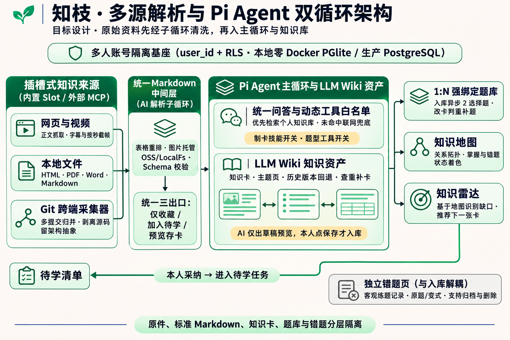

<div align="center">
  
  <h1>知枝 · Zhizhi Agent</h1>
  <p><strong>面向工程学习的 Agent-Native LLM Wiki 与练题系统。</strong></p>
  <p>将多源资料与 Git 提交清洗为标准 Markdown，沉淀进可追溯的个人知识库，并通过强绑定题库、独立错题本与知识地图完成巩固。</p>
  <p>
    <a href="https://github.com/sep-zxy/zhizhi-agent/actions/workflows/ci.yml"></a>
    <a href="https://github.com/sep-zxy/zhizhi-agent/actions/workflows/cd.yml"></a>
    <a href="LICENSE"></a>
  </p>
  <p>
    <a href="#项目定位">项目定位</a> ·
    <a href="#双循环架构与多源解析">双循环架构</a> ·
    <a href="#预设情境多页与知返题库">预设多页与题库</a> ·
    <a href="#当前阶段">当前阶段</a> ·
    <a href="#快速开始与开发">快速开始</a> ·
    <a href="docs/architecture.md">架构文档</a>
  </p>
</div>

## 项目定位

日常开发与学习中，文章、视频、文档、代码提交和 AI 对话分散在不同地方：收藏容易吃灰，聊过的问题容易忘，直接把原始文件塞进主对话模型又会迅速拉低回答质量。

**Zhizhi Agent** 把这些环节收拢到一套以个人知识库为核心的工作流里。它从第一版起按**多用户数据隔离**设计，支持零 Docker 本地单机运行，也支持直接部署到团队共享服务器。

系统由四个主要能力协同工作：

- **插槽式来源解析**：收纳网页链接、视频字幕与截帧、PDF/HTML/Word/Markdown 本地文件，以及 Git 跨端提交总结。
- **LLM Wiki 知识库**：以单个知识点为单元沉淀知识卡，支持查重补卡、主题组织、预览确认入库与历史版本回退。
- **统一 AI 问答**：单一对话入口。Pi Agent 自主判断优先检索当前账号知识库并附出处，库内未命中时触发联网搜索兜底。
- **知返题库与地图雷达**：知识卡强绑定 1:N 题库，错题页与入库完全解耦并支持归档删除，知识雷达基于知识地图拓扑识别薄弱与缺失区域。

项目目前处于早期开发阶段，已完成工程基座与 Pi Agent 核心层接入，各业务域正并行推进。以下两张图展示完整目标架构，当前已完成与待补齐部分见[当前阶段](#当前阶段)。

## 双循环架构与多源解析



原始材料不允许直接进入主对话循环，整个数据链路分为「解析子循环」与「Agent 主循环」两级：

1. **插槽式来源层与统一 Markdown 中间层**
   每种来源封装为可独立拆卸的插件槽（支持进程内插件与外部 MCP 服务）。强反爬的视频站点或基于开源项目二开的文档解析器可以单独升级或卸载，不影响主干运行。
   解析任务在异步 **AI 解析子循环** 中执行：完成 PDF 表格重排、图片托管（LocalFs / OSS）和去噪清洗，输出通过运行时 Schema 校验的 `Standard Markdown`，再由统一三出口决定去向：**仅收藏**、**加入待学**或**预览存卡**。

2. **Git 采集器剥离源码，保留架构抽象**
   Win/Mac 跨端采集器先将多次零碎提交去噪归并，提炼出架构层面的问题与方案权衡并转为标准 Markdown。知识卡和练习题不绑定原仓库、不囤大段业务源码，原仓库删除后依然完整可读。

3. **一套底座，零 Docker 本地与服务器双形态**
   全表强制绑定 `user_id` 并配合 RLS 隔离。本地开发或个人单机使用时，默认跑嵌入式 PGlite、本地文件存储和数据库持久化队列（V1 无需 Redis 与 Docker）；迁移到团队共享服务器时，只需配置 PostgreSQL 连接串与对象存储即可无缝切换。

| 使用场景 | 系统处理方式 |
|---|---|
| 收录网页、长视频或 PDF 资料 | 插件提取正文/字幕与关键帧，经解析子循环洗成标准 Markdown，预览删改后走统一三出口 |
| 复盘项目中的高频 Git 提交 | 采集器将同主题提交归并为少数架构要点，脱离具体源码片段生成独立知识卡或待学项 |
| 回顾既有笔记或探索未知问题 | 在统一问答页提问；Agent 优先查当前账号知识库并附出处，未命中时自动联网搜索 |
| 将对话结论沉淀进知识库 | 默认关闭「生成知识卡」开关仅对话与推旧卡；打开开关后出草稿预览，点击保存才正式入库 |

## 预设情境多页与知返题库


前端不做无约束的自由生成 UI，而是把页面骨架与 Agent 操控范围划清边界：

- **6 个预设情境独立页**：按功能划分为问答页、搜索页、知识来源、LLM Wiki、地图雷达、独立错题页。桌面端采用左侧导航 + 页内多栏，移动端自然收拢为底部 Tab；前端状态与 SSE 通信逻辑沉淀在零 DOM 的 `@zhizhi/client-core`，便于后续扩展移动客户端。
- **页内受控卡片槽与「钉住（Pin）」保护**：问答页中间区域只允许投放白名单内的预设卡片（知识卡、草稿对比卡、选择题卡等）。点击卡片右上角「钉住」后，后续对话不会覆写该槽位；记忆系统按 `user_id × 情境页` 持久化卡片排布与开关偏好，退出重登后自动续接。
- **题型工具化与开关白名单裁剪**：每种题型封装为独立 Agent Tool。V1 优先交付**选择题（单/多选 + 解析）**，V1.5 平滑扩充判断题、填空题、问答题与伪代码预测。界面开关直接决定下发给 Pi Agent 的 Tool 白名单，关闭的题型模型无法调用。
- **1:N 强绑定题库、入库双题与改卡判重**：独立 `card_questions` 表与知识卡强绑定，支持一卡多题挂靠。新卡保存立即返回，后台异步默认生成 2 道选择题（**认知理解** + **情境应用预测**，设置中提供全局开关）；多文档补卡或更新时，系统比对变更 Diff 与已有题目摘要，未覆盖才增量补题；再次复习优先抽未做或曾错题目，也支持追加新题。
- **独立错题页与地图驱动雷达**：错题页独立于入库流程，仅保存客观练题记录并支持**归档与删除**，防止错题无限积压；知识雷达以知识地图的拓扑与节点掌握度为输入，定位缺失知识点并推荐下一张待学卡。

## 当前阶段

开发基座已参考 DeepSeek Harness 工程规范搭建完毕，本地与 GitHub Actions CI（Host/Client 双面类型检查、`oxlint` type-aware、5 条静态门禁、单元测试、Web 构建）全部通过：

- **已完成基座**：
  - 全栈 TypeScript pnpm Monorepo（`@zhizhi/brand`、`errors`、`contracts`、`db`、`storage`、`jobs`、`plugin-sdk`、`agent-runtime`、`client-core`、`apps/server`、`apps/web`）。
  - **Pi Agent 核心层**：接入 `@earendil-works/pi-agent-core` 与 `@earendil-works/pi-ai`，支持 DeepSeek、OpenAI 及 OpenAI 兼容接口；无密钥时自动通过官方 `fauxProvider` 跑通完整工具循环与 `beforeToolCall` 拦截。
  - **存储与异步队列底座**：Drizzle ORM 18 张多租户表（PGlite 零 Docker 本地 / PostgreSQL 生产双驱动）、LocalFs / S3 存储抽象、基于 `async_jobs` 表的持久化队列。
  - **多租户服务端与 6 页前端骨架**：Hono 鉴权与双通道 SSE `/api/v1/chat/turn`、按情境页画布记忆 `/api/v1/canvas-state`、React 19 + Tailwind v4 + PWA 骨架。
- **并行推进中的 4 条业务线**（接口边界见 [docs/architecture.md](docs/architecture.md)）：
  1. **A 线（底座与 Wiki）**：知识卡与主题页 CRUD、预览保存与历史版本回退、中文全文检索。
  2. **B 线（插槽与中间层）**：网页/视频截帧与本地文件插件、AI 解析子循环 Worker、外部 Python MCP 插件模板。
  3. **C 线（Git 与地图）**：Win/Mac 跨端 Git 采集器、知识地图关系图谱与掌握状态着色。
  4. **D 线（Agent 与知返）**：真实检索与联网工具接线、入库异步 2 题与改卡判重 Worker、独立错题页（归档/删除）与地图驱动雷达。

## 快速开始与开发

环境要求：**Node.js `>= 24.12.0`**、**pnpm `10.x`**（本地开发不依赖 Docker）。

```sh
git clone https://github.com/sep-zxy/zhizhi-agent.git
cd zhizhi-agent
pnpm install
pnpm dev
```

启动后访问：
- 前端页面：`http://127.0.0.1:5173`
- 后端服务：`http://127.0.0.1:3080`（自动在 `.zhizhi/` 下初始化本地嵌入式 PGlite 与附件目录）

运行全套类型检查、Lint、5 条静态门禁与测试：

```sh
pnpm run check:all
pnpm --filter @zhizhi/web run build
```

如需在共享服务器使用容器拉起 PostgreSQL（含 pgvector）与 MinIO：

```sh
docker compose -f deploy/docker-compose.yml up -d
```

仓库已内置 GitHub Actions：`.github/workflows/ci.yml` 在每次 Push / PR 执行全套校验与构建；`.github/workflows/cd.yml` 在推送 `v*` 标签或手动触发时构建发布包并推送容器镜像至 GHCR。

## 目录结构

```text
zhizhi-agent/
├── AGENTS.md / CLAUDE.md       # 工程红线与 AI 协作规范
├── docs/
│   ├── architecture.md         # 五层架构与 4 人并行接口边界
│   ├── core-guidelines/        # G / B / F 编码规范
│   ├── specs/                  # 产品功能树 (v3.2) 与系统架构设计 (v1.2) HTML
│   └── assets/                 # 品牌图标与目标设计图
├── packages/
│   ├── shared/                 # brand（品牌 ID）、errors、contracts（共享 Zod 契约）
│   ├── infra/                  # db（PGlite/PG）、storage（LocalFs/S3）、jobs（持久化队列）
│   ├── ingest/plugin-sdk/      # 来源插槽注册表（Slot + MCP）与 StandardMarkdown 校验
│   ├── agent/runtime/          # Pi Agent 主循环、开关工具裁剪与独立子循环
│   └── client/core/            # 零 DOM 状态机与 SSE 解析（兼容未来移动端）
├── apps/
│   ├── server/                 # Hono 服务端与多租户鉴权中间件
│   └── web/                    # React 19 + Vite + Tailwind（6 个预设情境页 + PWA）
├── scripts/                    # 5 条静态门禁脚本（pnpm run check）
├── deploy/                     # Dockerfile 与可选 docker-compose.yml
└── .github/workflows/          # CI（校验与构建）与 CD（GHCR 镜像与 Release）
```

## 数据安全与隔离边界

- **四重多租户隔离**：鉴权中间件注入 `TenantContext` → 数据库 `withTenant()` 与 PostgreSQL RLS 兜底 → 检索前置 `user_id` 过滤 → 对象存储强制校验 `u/{user_id}/...` 路径前缀。
- **写库人工确认**：Agent 仅生成知识卡草稿投递到受控槽位，用户点击保存才正式落库并保留历史版本。
- **密钥隔离**：模型 API Key 由各账号自行配置，严禁将 `.env` 或凭据提交至代码仓库。

## 参与贡献与许可证

欢迎通过 Issue 与 Pull Request 参与共建，提交前请先阅读 [CONTRIBUTING.md](CONTRIBUTING.md) 与 [AGENTS.md](AGENTS.md)。

本项目遵循 [MIT License](LICENSE)。
